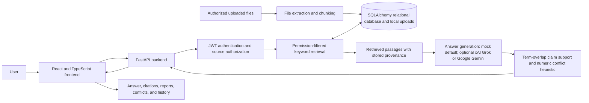

# Trotle AI — SYNAPSE '26 Presentation Content

Trotle AI is an evidence-first enterprise retrieval-augmented generation (RAG) application. It searches uploaded company documents, returns answers with source passages, and provides tools to inspect evidence, conflicts, document history, and relationships between saved evidence records.

**Intended audience:** enterprise employees, IT and security teams, compliance and audit professionals, researchers, analysts, managers, and administrators.

**Accuracy note:** Implementation statements below are based on the project README, inspected application source and configuration, architecture/workflow documentation, and test/build results. The backend API test suite passed (26 tests), the frontend production build and lint passed, and backend Python compilation passed during the latest verification. These checks do not prove live Grok connectivity, presentation-demo behavior, performance, or customer impact. No team information, official problem statement, repository URL, demo URL, performance measurement, or live demonstration result was supplied. The official PowerPoint template was not found in the project workspace.

## Slide 1 — Team & Project Details

- **Project Title:** Trotle AI — Evidence-First Enterprise RAG Platform
- **Team Name / Team ID:** [TO BE FILLED — actual team details required]
- **Official Problem Statement ID:** [TO BE FILLED — actual assigned ID required]
- **Official Problem Statement Title:** [TO BE FILLED — exact assigned title required]
- **Official Problem Statement Wording:** Not present in the inspected project files; supply the official wording rather than treating the project summary as the assigned statement.
- **Team Leader Name:** [TO BE FILLED — actual team details required]
- **Register Number:** [TO BE FILLED — actual team details required]
- **Department, Year, Section:** [TO BE FILLED — actual team details required]
- **Project Repository URL:** [TO BE FILLED — actual repository URL required; not supplied]
- **Demo URL:** [TO BE FILLED — actual demo URL required; not supplied]

## Slide 2 — Problem Statement

### Official Problem Statement

The official assigned problem statement and ID were not found in the inspected project files. Obtain the exact wording and ID from the team or event materials before submission.

**Project problem summary (not official event wording):** Organizations need a reliable way to retrieve information across fragmented data sources while handling outdated information, contradictory evidence, unsupported AI claims, and sensitive-data access restrictions.

### Problem Faced

- Company knowledge may be spread across documents, spreadsheets, databases, internal websites, and reports. This project currently ingests supported uploaded files; database and website ingestion connectors are not implemented.
- Employees can spend time searching separate sources to answer one question.
- Documents may disagree, be incomplete, or contain outdated information.
- Basic retrieval-augmented generation can surface irrelevant passages or produce claims that are not established by the retrieved text.
- Users need to inspect the source behind an answer.
- Restricted material must only be retrieved for users with permission.

### Why Existing Approaches Are Not Enough

Basic file search returns matches but may leave users to compare evidence manually. A generated answer without traceable source passages can be difficult to validate. Trotle AI combines keyword retrieval with stored citations, heuristic support labels, numeric conflict review, and source-access checks. These safeguards are useful but do not guarantee semantic correctness or identify every type of disagreement.

### Success Outcome

**Intended outcomes; no measured improvement figures are available:**

- Reduce the effort required to find relevant uploaded-document passages.
- Make answer evidence and source references easier to inspect.
- Surface some numeric disagreements for human review.
- Show when available retrieved evidence is insufficient.
- Apply source permissions before evidence is retrieved and sent to an optional language-model provider.

Performance should be evaluated with retrieval relevance, citation traceability, evidence-support review, conflict review, access-control, and provider-failure tests. No benchmark results or measured improvement percentages were found.

## Slide 3 — Proposed Solution

### Solution Summary

Trotle AI is a web application for asking questions about authorized, uploaded company documents. It retrieves matching passages, presents source references, labels claim support using deterministic term overlap, and can surface numeric disagreements for review. When no matching evidence is available, it can return an insufficient-evidence response rather than fabricate a sourced answer.

### Target Users / Stakeholders

**Primary end users**

1. Employees searching internal knowledge.
2. IT and security teams checking policies and system reports.
3. Compliance and audit professionals reviewing documented evidence.
4. Researchers and analysts comparing information.
5. Managers making decisions based on source material.

**Administrators**

- Administrators manage users, source configuration, and access assignments. Database, website/API, and cloud-storage ingestion adapters are not implemented.
- Admins and managers have access to selected review, reporting, and export actions according to application role checks.

### Core Feature 1 — Multi-Source Retrieval

- **Implemented:** File upload and text extraction for PDF, DOCX, TXT, Markdown, CSV, and XLSX files.
- Extracted text is chunked and stored with document and source metadata in the relational database; uploaded originals are stored locally.
- PDF extraction preserves page numbers; other supported formats do not currently provide page-level references.
- Retrieval is deterministic local keyword matching with a simple score and up to eight chunks. Questions that ask for recent/current information can use the document update timestamp as a secondary sort, but this is not source-authority or effective-date reasoning.
- **Not implemented:** PostgreSQL-record, internal website/API, cloud-drive, or public web search ingestion. Qdrant is present in optional Docker configuration but the application does not create embeddings or use Qdrant for retrieval.

### Core Feature 2 — Evidence Verification and Conflict Detection

- Citations preserve stored source/document/version details, quoted text, and available page metadata.
- Claim support labels use keyword overlap with retrieved text: Supported, Partly Supported, or Not Enough Evidence. This is a heuristic, not semantic entailment or an independent correctness check.
- The application can return an insufficient-evidence response if no usable matching chunks are found.
- Numeric disagreements in relevant passages can be recorded as reviewable conflicts. Detection is heuristic and may require human review; it does not determine which source is authoritative.
- Authorized admin/manager users can record a conflict resolution with an explanation; review actions are audited.

### Core Feature 3 — Evidence Intelligence Interface

| Interface / capability | Status | Scope and qualification |
|---|---|---|
| Answer Check | Implemented | Ask questions and inspect answers and available evidence. |
| Evidence Reports | Implemented | Permission-filtered claim/evidence explorer, coverage, gaps, conflicts, and citation-linked map; browser print can be used for PDF output. |
| Evidence Coverage | Implemented | Counts support categories; this is a source-match measure, not an accuracy score. |
| Conflicts | Partially implemented | Numeric disagreement detection and human review exist; the heuristic does not identify all conflict types or adjudicate authority. |
| Compare Versions | Implemented | Compares stored text between uploaded document versions using a line diff. |
| Change Alerts | Implemented for uploads | Changed uploads and deletions can generate alerts; no automatic external source synchronization exists. |
| Data Sources and Documents | Implemented for local uploads | Source and document management is connected to the upload workflow; external connectors are unavailable. |
| Settings | Implemented | Displays secret-free runtime provider and connector status; a configured provider is not proof of a successful provider call. |

### Innovation / Differentiation

Trotle AI's design focuses on making retrieved evidence inspectable: citations link answer claims to stored passages; conflicts and evidence gaps can be reviewed; upload versions and change events are traceable; and source access is checked before retrieval. This is the project's combination and emphasis, not a claim that no other product offers similar capabilities.

## Slide 4 — Solution Workflow

### Stage 1 — User Input

An authenticated user asks a natural-language question, for example: **“Does Server A comply with our MFA policy?”** The named policy and server records in this example are illustrative until a genuine dataset is added.

### Stage 2 — Processing / AI Logic

1. Validate the request and any explicitly selected sources.
2. Determine which sources the user may read.
3. Search ready document chunks in permitted sources using keyword overlap; return up to eight ranked matches.
4. Generate a grounded response from retrieved text. The default provider setting is `mock`; xAI/Grok answer generation is optional when configured with valid server-side credentials.
5. Compare answer claims with retrieved text using deterministic term overlap and attach stored citations where available.
6. Detect potential numeric disagreements using a heuristic and report them for human review.

**Limitations:** No vector/embedding retrieval or independent semantic-entailment verifier is configured. A document's update timestamp does not prove that it is current or authoritative.

### Stage 3 — Backend / Services

- FastAPI endpoints handle authentication, sources, file uploads, chat, evidence, documents, conflicts, alerts, reports, settings, and conversations.
- JWT-based authentication and role checks identify the user.
- Source ownership and explicit user/role access assignments constrain retrieval.
- File parsing, chunk storage, retrieval, answer generation, evidence handling, conflict review, and reporting run in backend services.

### Stage 4 — Database / Data Sources

**Working source path:** locally uploaded PDF, DOCX, TXT, Markdown, CSV, and XLSX documents.

**Configured database options:** SQLite for local development and PostgreSQL (including Supabase PostgreSQL connection configuration) for application data. Connecting the application database does **not** mean that PostgreSQL records are ingested as a searchable source.

**Not implemented as ingestion sources:** arbitrary PostgreSQL records, internal websites or APIs, cloud-storage repositories, and public web search.

### Stage 5 — Output / Action

- Answer text and available source quotations/citations.
- Claim support labels and evidence coverage.
- An insufficient-evidence response when there are no usable matching passages.
- Potential numeric conflicts for authorized human review.
- Source/version metadata and an upload-history comparison where available.

**Security note:** source permissions are enforced before restricted passages are retrieved for answer generation. If Grok is configured, retrieved evidence is sent to xAI after the application's sensitive-text masking rules are applied; organizations should review their data-sharing requirements.

### Workflow Diagram

```mermaid
flowchart LR
    U[Authenticated user asks a question] --> API[FastAPI API]
    API --> AUTH[JWT identity and source-access checks]
    AUTH -->|permitted sources only| RET[Keyword retrieval over ready chunks]
    FILES[Uploaded PDF, DOCX, TXT, MD, CSV, XLSX] --> INGEST[Extract text, preserve PDF pages, chunk]
    INGEST --> DB[(Relational database: documents, chunks, metadata)]
    RET --> DB
    DB --> EVID[Retrieved passages and source references]
    EVID --> GEN[Answer generation: mock default or optional configured Grok or Gemini]
    GEN --> CHECK[Term-overlap claim labels and heuristic numeric conflict detection]
    CHECK --> RESP[Answer, citations, evidence status, possible conflicts]
    RESP --> UI[React frontend: Answer Check and evidence views]
```

## Slide 5 — System Architecture

### Frontend

- React 19 and TypeScript, built and served in development with Vite.
- Tailwind CSS and Lucide icons.
- The frontend provides login, navigation, question submission, upload/source/document views, evidence display, conflict/version inspection, reports, history, and settings.

### Backend / API

- Python 3.11+ project using FastAPI, Pydantic, and SQLAlchemy.
- API routes cover authentication, sources and access, file uploads, chat, evidence, documents, reports, admin functions, settings, and conversations.
- Services implement file extraction/chunking and keyword retrieval/evidence handling.

### Database / Storage

- SQLAlchemy relational models store users, roles/access assignments, source and document metadata, chunks, conversations/answers, citations, conflicts, alerts, and audit records.
- SQLite is the local development default; PostgreSQL is configurable, including Supabase PostgreSQL via a server-side connection string and migrations.
- Uploaded files are stored in the backend's local uploads directory.
- Qdrant appears in optional Docker Compose configuration only; no application embedding/indexing path uses it.

### Retrieval and Indexing

- Supported uploaded files are extracted and split into text chunks; PDF page extraction retains page references.
- The current retriever scans permitted ready chunks and scores keyword matches. It does not use vector embeddings, Qdrant, or hybrid search.
- A time-aware question may use document update time as a ranking tie-breaker; effective dates and source authority are not modeled.

### AI / LLM Services

- `mock` is the default configured answer provider.
- Optional xAI/Grok or Google Gemini chat completion is implemented when `LLM_PROVIDER=grok` with `GROK_API_KEY`, or `LLM_PROVIDER=gemini` with `GEMINI_API_KEY`, is configured on the backend.
- Sensitive-text masking is applied before evidence is sent to the external provider.
- Answer generation and evidence checking are separate steps. The check is deterministic term overlap, not semantic entailment. A real xAI request has not been verified as successful for this presentation.
- No embedding provider is configured.

### Security Layer

- JWT bearer-token authentication and account-status checks.
- Role checks for administrative and manager actions.
- Source access from source ownership and explicit user/role assignments; retrieval is filtered to permitted sources.
- Selected evidence, exports, alerts, and saved evidence have access checks as described in the project README.
- Provider/database secrets are configured server-side through environment settings; never put them in frontend configuration or presentation content.
- Selected conflict reviews and evidence exports are audited. This is not a claim that every action has a comprehensive enterprise audit trail.

### Architecture Diagram

### Component Responsibilities

| Component | Technology | Responsibility | Implementation status |
|---|---|---|---|
| Web interface | React, TypeScript, Vite, Tailwind CSS, Lucide | Login, navigation, question entry, upload, and evidence views | Implemented |
| API | Python, FastAPI, Pydantic | Request handling, access checks, chat, sources, reports, and admin routes | Implemented |
| Persistence | SQLAlchemy; SQLite or PostgreSQL | Accounts, source/document records, chunks, evidence, and application history | Implemented/configurable |
| File pipeline | pypdf, python-docx, pandas | Extract supported file formats and split text into chunks | Implemented |
| Retrieval | Local keyword overlap and simple scoring | Search authorized document chunks | Implemented; not semantic/vector search |
| Answer generation | Mock default; optional xAI/Grok API | Draft response from retrieved evidence | Implemented/configurable; live provider success unverified |
| Evidence checks | Deterministic keyword overlap | Assign support labels and evidence coverage | Partially implemented; heuristic only |
| Conflict review | Numeric comparison heuristic and review route | Surface possible numeric differences for review | Partially implemented |
| Vector search | Qdrant in optional Docker configuration | No active application retrieval responsibility | Not implemented |
| External ingestion | PostgreSQL records, websites/APIs, cloud storage | Additional source ingestion | Planned/not implemented |

## Slide 6 — Technology Stack

| Category | Technology | Purpose | Status |
|---|---|---|---|
| Frontend | React, TypeScript | Interactive application UI | Implemented |
| Frontend | Vite | Frontend development and build tooling | Implemented |
| Frontend | Tailwind CSS | Styling | Implemented |
| Frontend | Lucide icons | UI icons | Implemented |
| Backend / APIs | Python, FastAPI | Backend services and HTTP API | Implemented |
| Backend / APIs | Pydantic | Request/configuration validation and schemas | Implemented |
| Backend / APIs | SQLAlchemy | Relational database access and models | Implemented |
| Database / storage | SQLite | Local-development database | Implemented |
| Database / storage | PostgreSQL; Supabase PostgreSQL connection option | Configurable application database | Implemented/configurable; Supabase Auth and Storage are not used |
| Database / storage | Local filesystem uploads | Store uploaded originals | Implemented |
| Database / storage | Alembic | Database migrations | Configured/used for schema upgrades |
| Database / storage | Qdrant | Optional Docker service configuration | Present in setup; not used by app retrieval |
| AI / algorithms | Mock answer provider | Default answer generation mode | Implemented default |
| AI / algorithms | xAI/Grok API | Optional answer generation from permission-filtered, masked retrieved evidence | Implemented/configurable; live call not verified |
| AI / algorithms | Keyword matching and deterministic score | Retrieve chunks and explain matched terms | Implemented |
| AI / algorithms | Term-overlap claim support | Label claims and calculate coverage | Implemented heuristic; not semantic verification |
| AI / algorithms | Numeric conflict heuristic | Surface some numeric disagreements | Implemented heuristic; human review needed |
| AI / algorithms | Embeddings / semantic reranking | Semantic retrieval | Not implemented |
| Deployment / hosting | Local Vite and Uvicorn development servers | Run frontend and backend locally | Documented |
| Deployment / hosting | Docker Compose | Optional local PostgreSQL and Qdrant services | Configuration present; no production deployment established |
| External APIs / tools | xAI API | Optional LLM answer generation | Configurable; requires valid server-side key |
| External APIs / tools | Database, website/API, cloud-drive ingestion | Import additional knowledge sources | Not implemented |

## Slide 7 — Core Feature Demonstration

### Demonstration Title

**Can Trotle AI Verify Whether a Server Meets the MFA Policy?**

### Demo Scenario

**Illustrative synthetic data only — these records were not found as a confirmed test dataset in the repository.**

- **Security Policy:** MFA is required.
- **Server Configuration Report:** MFA is disabled on Server A.
- **Older Audit Report:** Server A was previously reported as compliant.

### User Question

> Does Server A comply with our MFA policy, and why?

### Expected Processing

1. Upload the three synthetic documents through the supported file workflow.
2. Ask the question as a user who has access to those sources.
3. Retrieve matching chunks using keyword-based search.
4. Display the source passages and available version/date metadata.
5. Show claim support labels based on term overlap and any numeric conflict candidates the heuristic detects.
6. Explain that the older audit and configuration record appear inconsistent, without claiming that the system has established which source is authoritative.

The current conflict detector focuses on numeric disagreements; it may not flag this MFA on/off contradiction. The claim checker is lexical rather than semantic. Therefore, the exact expected conflict behavior must be exercised in a real demo before it is presented as a working result.

### Expected Output

**Expected interpretation, not a generated or tested application response:** the configuration report indicates that MFA is disabled, which conflicts with the stated policy requirement. The older audit report appears inconsistent with that configuration. A reviewer should check source dates and versions; the application does not determine policy authority or prove the actual live server configuration.

### Actual Demonstration Status

**Expected demonstration — not yet verified in the running application.** No evidence was found that this exact scenario was run, and no measured result should be claimed.

### Screenshot / Demo Evidence

- No genuine application screenshot for this scenario or presentation-ready test output was identified in the inspected project assets.
- `frontend/src/assets/hero.png` exists but is not evidence of this workflow.
- **Screenshot placeholder:** `[Insert a genuine screenshot after running and testing the MFA scenario.]`

## Slide 8 — Innovation, Feasibility & Impact

### Innovation

**Implemented foundation:** authorized keyword retrieval, stored citations, claim-support labels, an insufficient-evidence response for no-match cases, upload version history, reviewable numeric conflicts, and a bounded evidence relationship view.

**Important qualifications:** claim support is based on term overlap; conflicts are heuristic; source authority and effective dates are not modeled.

### Beneficiaries

- Employees seeking internal information.
- IT and security teams checking policies and system records.
- Compliance and audit professionals inspecting source evidence.
- Researchers and analysts comparing documents.
- Managers who need traceable information.
- Administrators managing users, source records, and permissions.

These are intended user groups; no customer deployment was verified.

### Expected Impact

Intended benefits include less manual searching, easier answer traceability, earlier visibility of some source disagreements, clearer communication when evidence is missing, and protection of restricted sources through access checks. These benefits have not been measured.

### Feasibility

The project already contains a React/TypeScript frontend, FastAPI/Python backend, SQLAlchemy relational persistence, supported file extraction, keyword retrieval, evidence views, and role/source access checks. A live demonstration requires a running backend and frontend, migrated database, representative uploaded files, an account with appropriate access, and (only for Grok-generated responses) valid xAI credentials. A mock answer provider is the default; do not present an external provider call as successful unless it has been tested.

### Scalability

Potential future extensions include semantic retrieval and reranking, more robust evidence verification, source authority/freshness metadata, supported database and external-source connectors, automated synchronization, and a formal evaluation dataset. These are future work, not current capabilities.

### Future Roadmap

1. Add evaluation datasets and repeatable tests for retrieval, citations, support labels, conflicts, and permissions.
2. Improve semantic retrieval and reranking beyond local keyword matching.
3. Strengthen claim verification beyond term overlap.
4. Add source authority, effective-date, and freshness handling.
5. Implement secure connectors and synchronization for approved PostgreSQL, website/API, and cloud sources.
6. Improve conflict detection for non-numeric disagreement and make its limitations clear.
7. Improve evaluation and access-control assurance with repeatable, labeled test datasets.

## Project Status and Limitations

| Area | Status | Evidence-based qualification |
|---|---|---|
| Frontend functionality | Implemented | React app contains Answer Check, History, Sources, Documents, Conflicts, Alerts, Versions, Coverage, Reports, and Settings views. |
| Authentication and permissions | Implemented | JWT authentication, roles, ownership/access assignments, and retrieval-time source filtering exist. |
| Document ingestion | Implemented | Upload parsing supports PDF, DOCX, TXT, Markdown, CSV, and XLSX; originals are locally stored. |
| Keyword retrieval | Implemented | Local deterministic keyword match and ranking over permitted ready chunks. |
| Vector retrieval | Not implemented | Qdrant is in optional Docker setup, but the app does not create embeddings or index/search vectors. |
| Claim verification | Partially implemented | Deterministic term-overlap labels; not semantic entailment or a correctness guarantee. |
| Conflict detection | Partially implemented | Numeric conflicts can be surfaced for review; heuristic coverage is limited. |
| Source authority and freshness | Partially implemented / not implemented | Some timestamp-based ordering and upload history exist; effective dates and authority scoring do not. |
| PostgreSQL source connector | Not implemented | PostgreSQL can be the application's database; PostgreSQL records are not ingested as a source. |
| Website/API/cloud connectors | Not implemented | No adapter or scheduled synchronization engine is available. |
| Change alerts | Implemented for upload events | Re-upload/deletion history is tracked; no external source sync. |
| Evidence Reports | Implemented | Permission-filtered report and JSON/CSV export for authorized roles; PDF is via browser print, not a backend PDF exporter. |
| Evaluation | Automated checks available; no reported benchmark | Latest verification: 26 backend API tests passed; frontend production build and lint passed; backend Python compilation passed. No measured accuracy, latency, or impact benchmark is available. |
| Deployment | Local development configured | Local startup and optional Docker services are documented; production deployment was not verified. |
| Live xAI/Grok or Gemini provider | Configurable, unverified | Backend integrations exist; a successful real provider call was not confirmed for this presentation. |
| Official SYNAPSE template | Not found in workspace | The supplied project workspace did not contain the named PPTX template at inspection time. |

## Final Presentation Summary

### One-Sentence Project Pitch

Trotle AI helps authorized users search uploaded company documents and inspect the source evidence, uncertainty, and possible conflicts behind an answer.

### 30-Second Spoken Explanation

“Company knowledge is often spread across documents, and answers can be hard to verify. Trotle AI lets authorized users ask questions about uploaded files, retrieves matching passages, and shows citations and evidence-support labels. It can surface some numeric disagreements for review and keeps upload versions visible. Its current search is keyword-based and its evidence checks are heuristic, so it does not claim semantic proof or decide which source is authoritative.”

### Three Key Benefits

1. Source passages and citations make retrieved evidence easier to inspect.
2. Insufficient evidence and some numeric disagreements can be surfaced for review.
3. Source permissions are applied before retrieval of restricted material.

### Three Key Differentiators

1. Claim-linked evidence views in an evidence-first workflow.
2. Upload-version comparison, change alerts, and evidence reports.
3. Explicit qualification of support labels and conflicts as heuristics rather than guarantees.

### Most Convincing Demo Scenario

Upload a security policy, a server configuration report, and an older audit report; ask whether Server A meets the MFA requirement; show the actual retrieved passages and source metadata; and explain any inconsistency without asserting authority the records do not establish. The MFA disagreement must be tested live because the current conflict detector is numeric-focused.

### Missing Details the Team Must Supply

- Actual team name and team ID.
- Team leader name, register number, department, year, and section.
- Official problem statement ID, title, and exact wording.
- Actual repository URL and demo URL, if available.
- A genuine screenshot or test result from a completed demonstration.
- Confirmed outcomes of any live provider call or other tests the team wants to claim.
- The official `SYNAPSE_26_Standard_Hackathon_PPT_Template.pptx` file before generating the presentation.

## Slide-Ready Content

Use these concise points when transferring content to the eight-slide template. The illustrative scenario and intended benefits must remain labeled; do not present them as measured or tested results.

### Slide 1 — Team & Project Details

- **Trotle AI — Evidence-First Enterprise RAG Platform**
- Team / ID: [TO BE FILLED — actual team details required]
- Official Problem ID / Title: [TO BE FILLED — actual assigned details required]
- Leader / Register No. / Department / Year / Section: [TO BE FILLED — actual team details required]
- Repository / Demo: [TO BE FILLED — actual URLs required]

### Slide 2 — Problem Statement

- Official assigned statement: not available in inspected project files; insert exact event wording.
- Project problem summary: organizational knowledge is fragmented; information can conflict or become outdated, answers need traceable evidence, and restricted content needs access controls.
- Intended outcomes: easier retrieval, source-linked answers, visible evidence gaps and some conflicts, permission-filtered access.
- No performance improvement has been measured.

### Slide 3 — Proposed Solution

- Search permitted uploaded documents and show source passages for answers.
- Users: employees; IT/security, compliance/audit, research, analysis, and management teams. Administrators configure users and access.
- Implemented uploads: PDF, DOCX, TXT, Markdown, CSV, XLSX; keyword retrieval.
- Evidence Reports, coverage, versions, upload alerts, and conflict review are available with the limitations above.
- Support checking is term overlap; conflict detection is numeric heuristic. Database/web/cloud ingestion and semantic retrieval are not implemented.

### Slide 4 — Solution Workflow

**User question → FastAPI authentication and source access checks → keyword retrieval over permitted uploaded-file chunks → answer generation (mock default or optional configured Grok) → term-overlap evidence labels and numeric conflict heuristic → cited answer and evidence views.**

- Permissions are checked before restricted evidence reaches answer generation.
- No-match questions can receive an insufficient-evidence response.
- Source inputs are uploaded PDF/DOCX/TXT/Markdown/CSV/XLSX files; external connectors are not implemented.

### Slide 5 — System Architecture

- **Frontend:** React, TypeScript, Vite, Tailwind CSS.
- **Backend:** Python, FastAPI, Pydantic, SQLAlchemy.
- **Data:** SQLite locally or configurable PostgreSQL; local file uploads; document text/chunks and metadata stored relationally.
- **Retrieval:** local keyword matching; Qdrant is not used by application search.
- **Answer generation:** mock by default; optional xAI/Grok or Google Gemini API; successful live calls unverified.
- **Security:** JWT authentication, role/source permissions, server-side secrets, selective audit records.

### Slide 6 — Technology Stack

- React / TypeScript / Vite / Tailwind CSS / Lucide.
- Python / FastAPI / Pydantic / SQLAlchemy / Alembic.
- SQLite local; PostgreSQL/Supabase PostgreSQL configurable as app database.
- File extraction: pypdf, python-docx, pandas; PDF pages retained.
- Keyword retrieval; term-overlap support checks; numeric conflict heuristic.
- Optional xAI/Grok or Google Gemini answer generation. No embeddings, vector retrieval, production deployment, or external source connectors confirmed.

### Slide 7 — Core Feature Demonstration

- **Illustrative synthetic scenario, not a confirmed repository dataset:** policy requires MFA; Server A configuration says MFA disabled; older audit says compliant.
- Ask: “Does Server A comply with our MFA policy, and why?”
- Show the retrieved passages, citations, dates/versions, and qualified evidence assessment.
- Expected interpretation: configuration suggests a policy mismatch; older audit appears inconsistent; source authority is unresolved.
- **Expected demonstration — not yet verified in the running application.** Numeric-focused conflict detection may not flag this non-numeric contradiction.
- Screenshot: [Insert genuine screenshot after testing.]

### Slide 8 — Innovation, Feasibility & Impact

- Evidence-first workflow: inspectable passages, citations, upload history, permission checks, and reviewable possible conflicts.
- Intended beneficiaries: employees, IT/security, auditors, researchers, analysts, managers.
- Intended benefits: easier search and verification, clearer evidence gaps, and stronger access control; no measured impact claimed.
- Feasible local demo with existing web stack, migrated database, uploaded test files, running services, and optional valid Grok credentials.
- Future work: semantic retrieval, stronger verification, authority/freshness metadata, connectors/synchronization, and formal evaluation.
