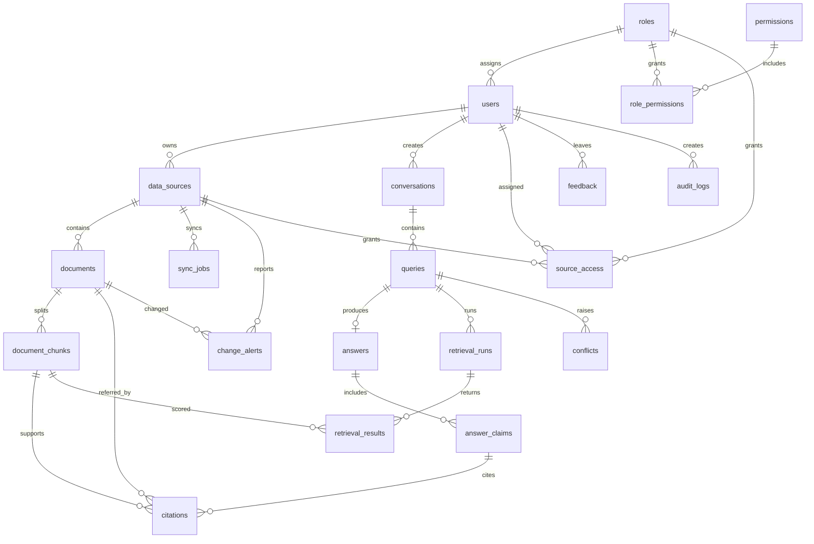

# ER Diagram

`answers.evidence_coverage` stores the claim-status counts and ratio for that answer.
`conflicts.evidence` stores the source snapshots shown at review time. Citations retain
quoted text, document/version linkage, page number when available, and support status;
deleting a document from search is a soft delete so older answer evidence remains
traceable. `change_alerts.dedupe_key` prevents repeated alerts for the same uploaded
version change or deletion.
